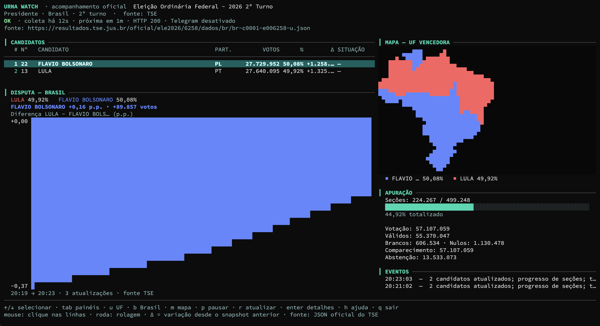

# Urna Watch

Monitor dos **resultados oficiais** das eleições brasileiras publicados pelo
Tribunal Superior Eleitoral (TSE). Coleta arquivos JSON oficiais, normaliza os
dados, detecta alterações relevantes, persiste o último estado válido e envia
notificações para um grupo do Telegram. A operação principal acontece em uma
TUI (Bubble Tea + Lip Gloss) com teclado e mouse; o mesmo binário roda sem TUI
em servidores e containers.

> Projeto independente, não oficial. A fonte é o portal de resultados do TSE.
> O TSE não publica um contrato de API estável; leia
> [`docs/research/tse-data-source.md`](docs/research/tse-data-source.md) antes
> de operar em produção.

[](https://github.com/tofoli/urna-watch/actions/workflows/ci.yml)
[](https://github.com/tofoli/urna-watch/releases)
[](https://go.dev/)
[](LICENSE)



## O que já foi validado

- Fonte oficial 2026: config comum, 1º turno, 2º turno federal, 2º turno
  estadual (AM) e um resultado municipal suplementar (Narandiba/SP).
- Requisições reais via Browser Harness e reprodução por `curl`; os valores da
  página oficial conferem com os arquivos usados pelo coletor.
- `ETag`/`Last-Modified`, `304`, cache HTTP, cabeçalhos de rate limit e o
  intervalo de atualização do SPA (120s).
- Testes automatizados com fixtures reais e servidores HTTP locais.
- Envio real de mensagem para um grupo do Telegram em 2026-10-25.

## Princípios

- Dados oficiais e estruturados; **não** há scraping de HTML na coleta.
- Nenhum endpoint ou campo é inventado; evidências ficam em `docs/research/`.
- O último snapshot válido nunca é sobrescrito por resposta inválida ou mais
  antiga.
- A linha de base evita enxurrada de mensagens históricas.
- Notificações têm IDs determinísticos e outbox durável; a semântica é
  **at-least-once** (pode haver duplicata após falha ambígua entre envio e
  confirmação), com deduplicação lógica.
- `tf=s` é a única indicação de totalização final. `pst=100` sozinho não é
  tratado como “apuração concluída”.
- Percentuais exatos são inteiros (nano-percentual); comparações não usam
  `float`.
- Tokens nunca vão para logs, TUI, estado ou repositório.

## Requisitos

- Go **1.27+** (o módulo declara `go 1.27.3`).
- `make`, `git`.
- Opcional: Docker/Compose, `golangci-lint` 2.x.
- Acesso HTTPS a `resultados.tse.jus.br` e (se habilitado) `api.telegram.org`.

## Instalação

### Imagem Docker (GitHub Container Registry)

```sh
docker pull ghcr.io/tofoli/urna-watch:0.1.0

# headless, com estado persistente e endpoint local de status
docker run -d --name urna-watch --restart unless-stopped \
  -v urna-data:/app/data \
  -p 127.0.0.1:8080:8080 \
  --env-file .env \
  ghcr.io/tofoli/urna-watch:0.1.0
```

Para abrir a TUI em um terminal interativo:

```sh
docker run --rm -it -v urna-data:/app/data \
  -e URNA_TUI=true --env-file .env \
  ghcr.io/tofoli/urna-watch:0.1.0
```

Binários Linux amd64/arm64 e notas de versão ficam em
[Releases](https://github.com/tofoli/urna-watch/releases). A imagem também é
publicada como `ghcr.io/tofoli/urna-watch:latest`.

### Do código-fonte

```sh
cp .env.example .env       # ajuste; NÃO versione .env
make check                 # gofmt + vet + testes + build
make build
./bin/urna-watch --validate --no-tui
```

Execução interativa (padrão 2º turno presidencial de 2026):

```sh
# O binário lê variáveis exportadas no shell; .env não é carregado sozinho.
export URNA_ELECTION=6258 URNA_CONTEST=1 URNA_UF=br
make run
```

Execução headless (servidor):

```sh
URNA_TUI=false ./bin/urna-watch --no-tui
```

Coleta única, sem persistir nem notificar:

```sh
./bin/urna-watch --once --no-tui --no-telegram
./bin/urna-watch --once --json --no-tui --no-telegram | jq .
```

Validação da fonte e do normalizador:

```sh
./bin/urna-watch --validate --no-tui
```

## Configuração

Principais variáveis (lista completa em [`docs/configuration.md`](docs/configuration.md)):

| Variável | Padrão | Descrição |
| --- | --- | --- |
| `URNA_ELECTION` | `6258` | código da eleição no config oficial |
| `URNA_CONTEST` | `1` | código do cargo (`--cargo` é alias) |
| `URNA_UF` | `br` | `br` ou UF (`sp`, `am`, ...) |
| `URNA_MUNICIPALITY` | vazio | código de 5 dígitos; exige UF |
| `URNA_POLL_INTERVAL` | `120s` | mínimo 30s |
| `URNA_STATE_PATH` | `./data/state.json` | estado durável (uma eleição por arquivo) |
| `URNA_TUI` | `true` | desligado automaticamente se stdout não for TTY |
| `URNA_STATUS_ADDR` | vazio | ex.: `127.0.0.1:8080` para `/healthz` e `/status` |
| `TELEGRAM_ENABLED` | `false` | habilita envio |
| `TELEGRAM_BOT_TOKEN` | — | segredo do BotFather |
| `TELEGRAM_CHAT_ID` | — | id do grupo (negativo) |

Configuração opcional por JSON (validada com campos estritos):

```sh
./bin/urna-watch --config config.example.json
```

Precedência: padrões < arquivo JSON < variáveis de ambiente < flags.

## Telegram

1. Crie um bot com o **@BotFather** e copie o token.
2. Crie/adicionar o bot ao grupo. O bot precisa poder enviar mensagens; para
   receber comandos ele não depende de privacy mode, mas o envio é o essencial.
3. Envie qualquer mensagem no grupo e descubra o `chat.id`:

   ```sh
   TOKEN='<seu-token>'
   curl -sS "https://api.telegram.org/bot${TOKEN}/getUpdates" \
     | jq '[.result[] | (.message.chat // .my_chat_member.chat) | select(. != null)] | unique_by(.id)'
   ```

   O id de grupo é negativo (ex.: `-100...` ou `-5...`). Use **apenas** o grupo
   desejado.
4. Exporte `TELEGRAM_ENABLED=true`, `TELEGRAM_BOT_TOKEN` e `TELEGRAM_CHAT_ID`.
5. Inicie o monitor. A primeira coleta envia uma **linha de base** (uma única
   mensagem) se `TELEGRAM_BASELINE=true`.

O bot **não** consegue ler mensagens do grupo; ele só envia. O token foi
projetado para ser secreto: se ele aparecer em logs, histórico ou captura de
tela, revogue e gere outro no BotFather.

```sh
# teste de fumaça do token (não envia mensagem)
curl -sS "https://api.telegram.org/bot${TELEGRAM_BOT_TOKEN}/getMe" | jq .
```

## Notificações

As mensagens são curtas e pensadas para leitura no celular:

```text
📊 Urna Watch — atualização

🗳️ Presidente · 2026 · 2º turno
Brasil · atualizado 25/10/2026 19:10:32

1. LULA (PT) — 52,13% · 1.068.370 votos
2. FLAVIO BOLSONARO (PL) — 47,87% · 981.000 votos

Mudanças
• LULA +27.610 (52,13%)
• Seções +213 (1,65%)

Apuração: 1,65% das seções totalizadas (8.218 de 499.248)

Ver no site do TSE
```

- O link é sempre a **página humana oficial** do TSE, nunca o JSON.
- Totais secundários (válidos/brancos/nulos/abstenção) continuam no painel da
  TUI, mas não poluem o Telegram.
- Com `TELEGRAM_CHARTS=true` (padrão), a mensagem é enviada como **foto com
  legenda**. Em eleição federal/Brasil, com `TELEGRAM_MAPS=true` (padrão), a
  imagem é um painel no estilo TV: barras dos candidatos + **mapa do Brasil
  colorido pelo candidato vencedor em cada UF**. Sem dados de mapa, usa o
  gráfico de barras; sem votos, usa texto.
- Se a legenda exceder 1024 unidades UTF-16, o app envia texto normal.
- `TELEGRAM_CHARTS=false` desabilita imagens; `TELEGRAM_MAPS=false` mantém o
  gráfico de barras no Telegram, sem buscar as 27 UFs para ele. O mapa da TUI
  (`m`) é independente e continua disponível sob demanda.
- O mapa busca os arquivos oficiais das 27 UFs com concorrência limitada, cache
  de 60s e ETag. Estados sem votos ficam cinza; pode haver defasagem entre UFs.

## TUI

```text
URNA WATCH · acompanhamento oficial
Presidente · Brasil · 2º turno · fonte: TSE
OK · coleta há 12s · próxima há 1m48s · HTTP 304 · Telegram em dia
```

- `↑/↓` ou `j/k`: selecionar/rolar
- `tab`: alternar candidatos ↔ eventos
- `enter`: detalhes do candidato/evento
- `u`: abrir a **visão por UF** (eleição federal)
- `b`: voltar ao consolidado Brasil
- `m`: abrir o **mapa do Brasil por UF vencedora** em tela cheia
- Painel **DISPUTA** abaixo dos candidatos: percentuais, vantagem atual em
  pontos percentuais/votos e gráfico histórico da diferença entre os dois
  primeiros colocados.
- `p`: pausar/retomar polling
- `r`: atualização imediata
- `h`/`?`: ajuda
- `q`: sair
- Mouse: clique nas linhas e use a roda para rolar.

A escolha de UF e o mapa são feitos **na própria TUI** (`u` e `m`), sem
variável de ambiente. O painel de disputa usa um histórico local limitado
(240 pontos) persistido no estado, não um arquivo de snapshots completo.

Em terminais com pelo menos 100 colunas, o mapa também aparece automaticamente
na tela inicial; `m` abre a versão em tela cheia. A visão por UF é carregada
sob demanda do arquivo oficial da UF, é somente leitura e **não** altera a
linha de base, os eventos nem as notificações do consolidado Brasil. Ela pode
ficar defasada em relação ao consolidado; o painel mostra o horário da carga e
a fonte.

Para consultar uma UF fora da TUI (inclusive com o Docker rodando o consolidado):

```sh
URNA_UF=sp ./bin/urna-watch --once --no-tui --no-telegram
```

A coleta, a persistência e o Telegram continuam em goroutines próprias; a TUI
apenas lê um snapshot imutável. Em terminal sem TTY, o modo headless é usado.

## Docker

```sh
cp .env.example .env   # opcional; sem .env o compose usa os padrões
docker compose up -d --build   # constrói a imagem local do repositório
docker compose logs -f
curl -sS http://127.0.0.1:8080/healthz
curl -sS http://127.0.0.1:8080/status | jq '{paused, poll, telegram, snapshot: .snapshot.sourceVersion}'
docker compose down
```

O container roda como usuário sem privilégios, com filesystem raiz somente
leitura e volume nomeado `urna-data` (o diretório da imagem já pertence ao
usuário `urna`, então o volume inicializa gravável). O token entra por variável
de ambiente; nunca é embutido na imagem. Para usar bind mount, crie o diretório
e ajuste a posse para o UID/GID do container (`100:101`).

## Persistência e entrega

- Estado em JSON com escrita atômica (`tmp` + `fsync` + `rename`), permissão
  `0600`.
- Inclui último snapshot válido, validadores HTTP, eventos recentes e outbox de
  notificações.
- Se o Telegram estiver desabilitado, notificações pendentes antigas são
  marcadas como suprimidas (não são enviadas ao reativar).
- Reinícios retomam a fila pendente; deduplicação por ID determinístico evita
  reenvio da mesma geração.
- Uma única instância deve escrever em cada `URNA_STATE_PATH`.
- O estado pertence a uma seleção (eleição/cargo/abrangência); trocar de
  eleição exige outro caminho de estado.

## Arquitetura (resumo)

```text
TSE JSON → Adapter → Normalizer/Validator → Detector → Store (snapshot + eventos + outbox)
                                                           ↓
TUI / Status HTTP ← App ← Poller (retry/backoff/304)       Telegram Adapter
```

Componentes em `internal/`: `tse`, `domain`, `detector`, `polling`, `store`,
`notification`, `telegram`, `tui`, `observability`, `app`, `config`.
Detalhes em [`docs/architecture.md`](docs/architecture.md) e ADRs em
[`docs/adr/`](docs/adr/).

## Desenvolvimento

```sh
make fmt-check
make lint          # go vet + golangci-lint quando instalado
make test
make test-race
make check
```

Testes padrão não acessam TSE nem Telegram; usam fixtures e `httptest`.
`go test ./...` cobre parser, config, detector, store, polling, Telegram, TUI e
um pipeline completo com servidores simulados.

## Documentação

- [Pesquisa da fonte](docs/research/tse-data-source.md)
- [Malha do mapa](docs/research/brazil-map.md)
- [Arquitetura](docs/architecture.md) · [ADRs](docs/adr/README.md)
- [Configuração](docs/configuration.md) · [Desenvolvimento](docs/development.md)
- [Operação](docs/operations.md) · [Troubleshooting](docs/troubleshooting.md)
- [Segurança](docs/security.md) · [Testes](docs/testing.md)
- Runbooks: [setup](docs/runbooks/initial-setup.md),
  [monitoramento](docs/runbooks/election-monitoring.md),
  [incidentes](docs/runbooks/incident-response.md)

## Limitações conhecidas

- Fonte sem contrato público; caminhos podem mudar.
- `.json` escolhido em vez de validar JWS (ver ADR 0003).
- Apenas dados de 2026 foram validados; 2024 retornou 404 nos caminhos testados.
- O MVP não alterna eleições em tempo de execução; use outra instância/estado.
- A visão por UF é por demanda e não é persistida; ela não gera notificações.
- Cores fixas por candidato: **Lula/PT em vermelho** e **Bolsonaro/PL em azul**,
  independentemente da posição atual.
- O mapa do Telegram depende de 27 arquivos de UF e pode refletir uma geração
  ligeiramente diferente do consolidado Brasil. Ele mostra a UF com mais votos
  por candidato; não é projeção nem declaração de eleito.
- A variação “desde o snapshot anterior” reseta após reinício; o histórico do
  painel de disputa é persistido (até 240 pontos), mas começa a acumular a
  partir da primeira execução desta versão.
- Município: URL validada, mas a coerência código↔UF é delegada ao 404 da fonte.
- Releases e imagens Docker são gerados por tag `v*` no GitHub Actions
  (`.github/workflows/release.yml`).

## Segurança

Leia [`docs/security.md`](docs/security.md). Em resumo: não versione `.env`,
nunca registre tokens, trate JSON externo como não confiável, use HTTPS,
mantenha o container sem privilégios e faça backup do estado antes de mudanças.

## Repositório

- Código: https://github.com/tofoli/urna-watch
- Releases: https://github.com/tofoli/urna-watch/releases
- Imagem: `ghcr.io/tofoli/urna-watch`
- Issues: https://github.com/tofoli/urna-watch/issues

## Licença

MIT — veja [LICENSE](LICENSE).
